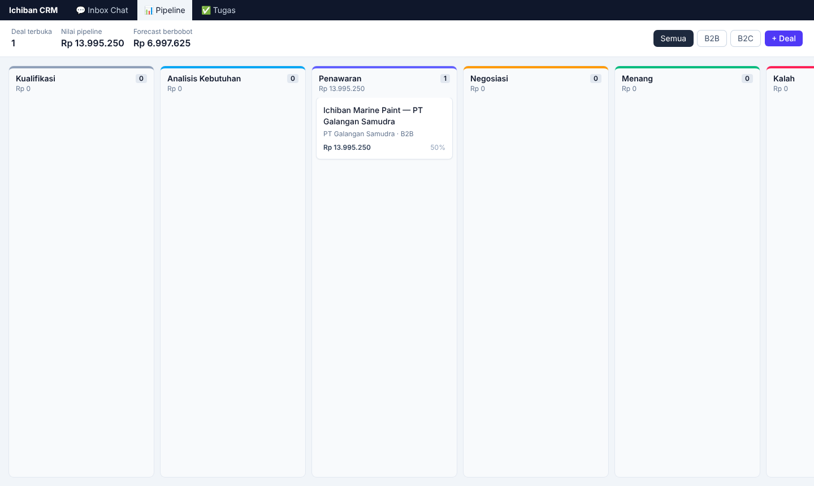
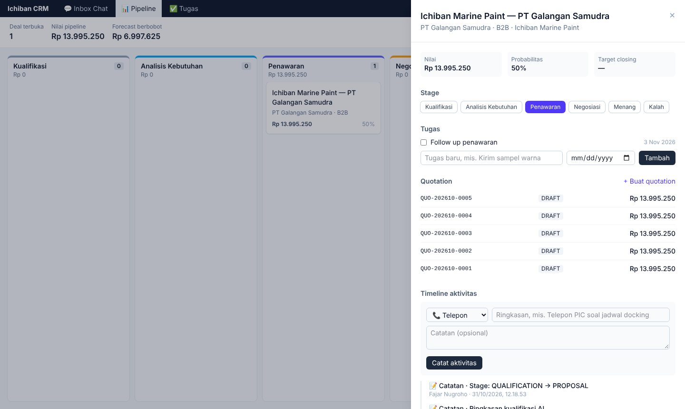
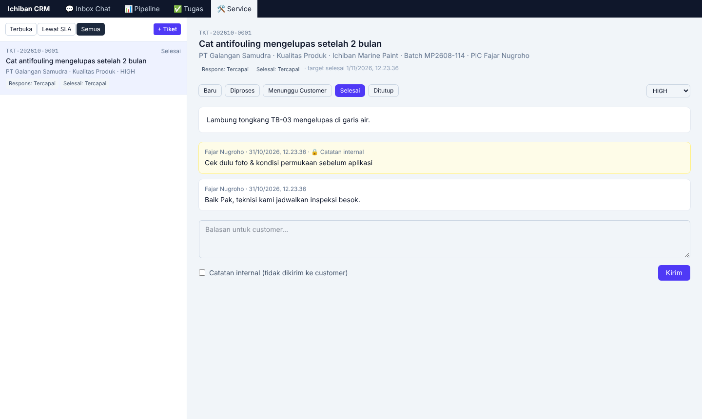
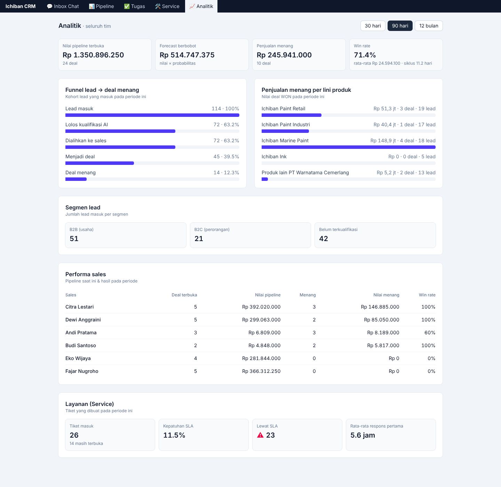
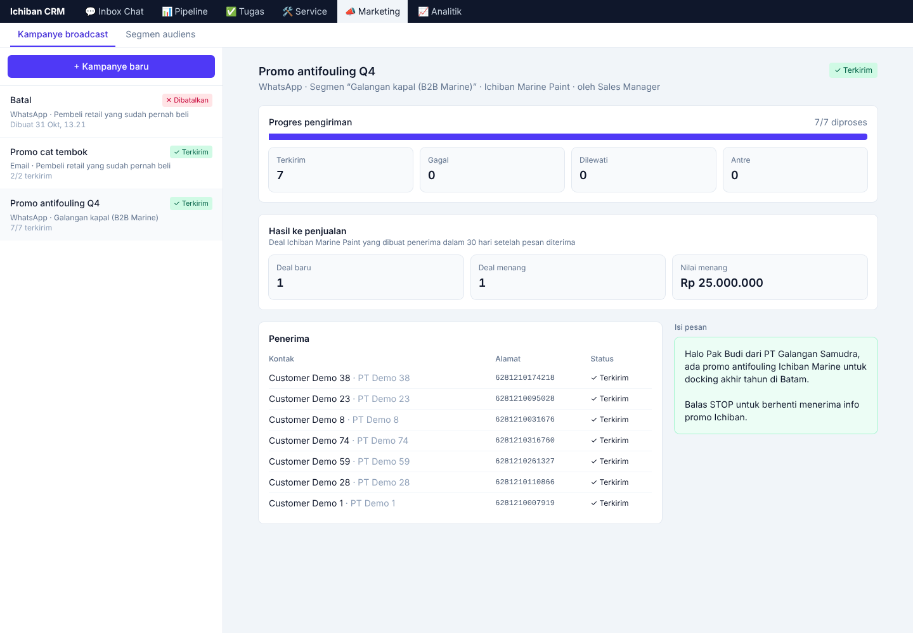
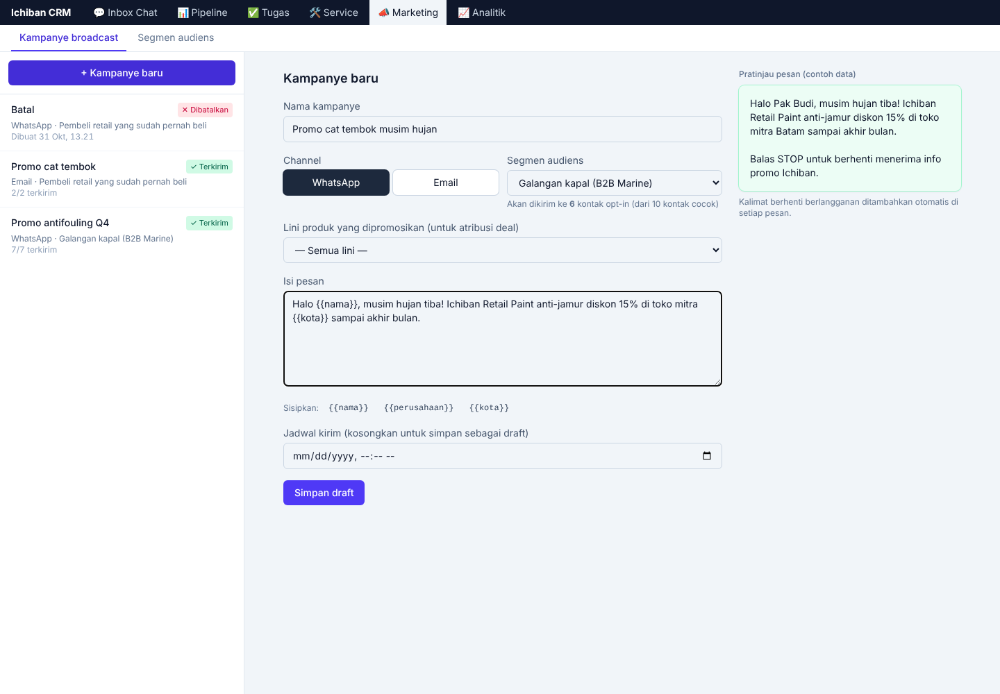
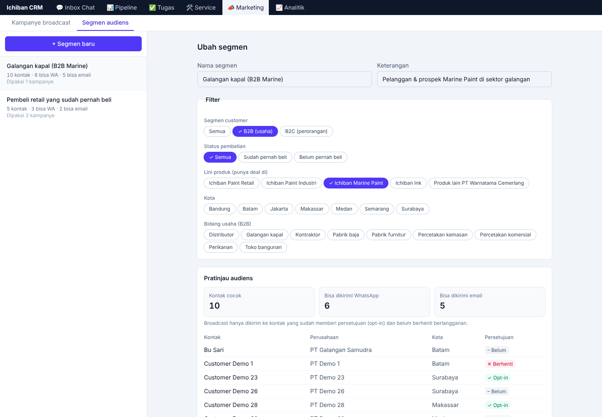
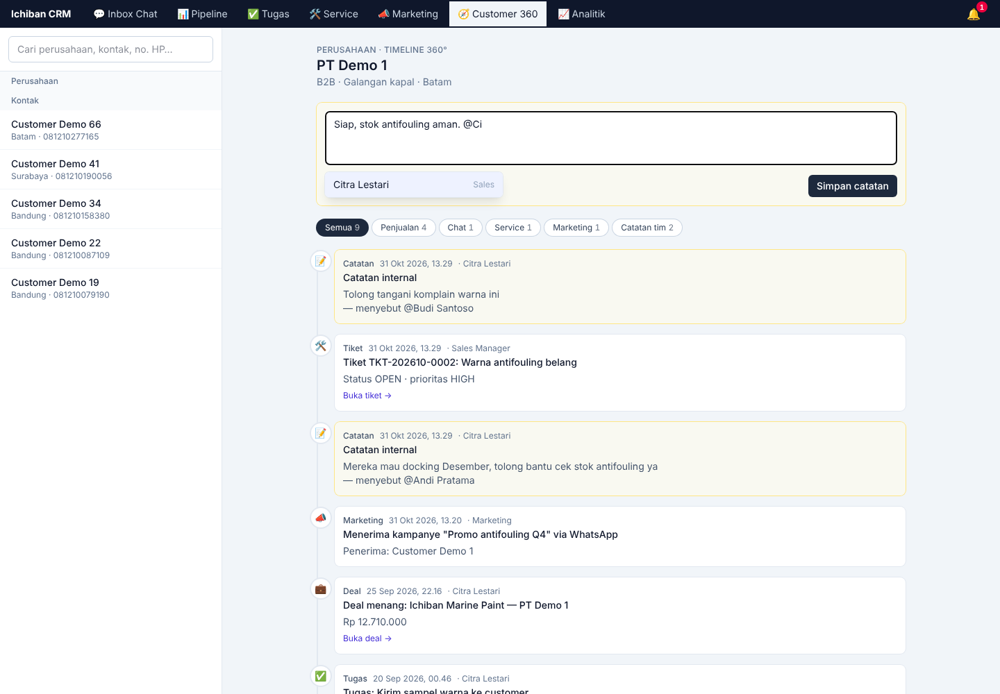
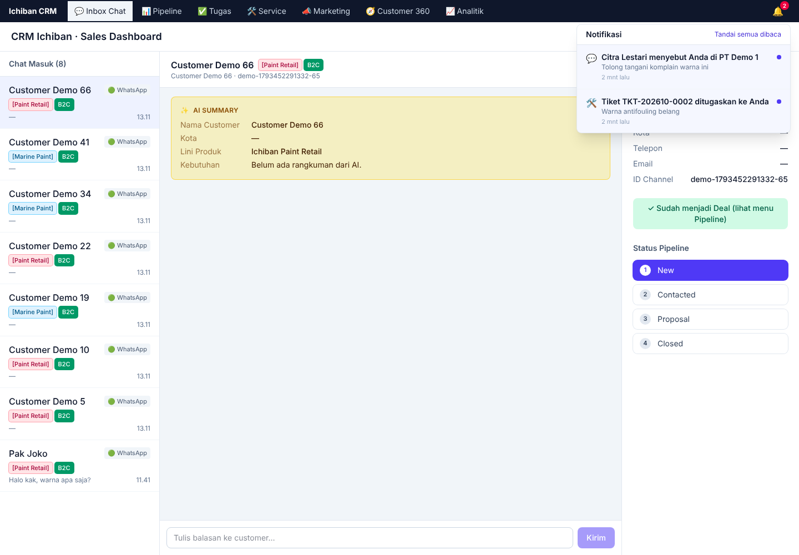

# CRM Ichiban: Kualifikasi AI → Skill-Based Routing → Dashboard Sales

Blueprint dan implementasi referensi CRM **B2B + B2C** untuk produk Ichiban / PT Warnatama Cemerlang. Calon customer chat via webhook. **AI Agent (Claude)** menentukan segmen (B2B atau B2C) dan lini produk yang dicari (Ichiban Paint Retail, Paint Industri, Marine Paint, Ink, dll.), lalu mengumpulkan data wajib segmen tersebut. Setelah itu sesi dialihkan dengan **Round Robin berbasis skill (lini produk × segmen)** ke Sales/Customer Advisor yang tepat, yang menerima chat dan rangkuman AI **secara real-time** di dashboard.

## 1. Arsitektur

```
 Channel (WA/Web widget)                Backend (Express + TS)                        Frontend (React + Tailwind)
 POST /webhook/incoming-message
   Pesan customer ─────▶ chat.routes ──▶ processIncomingMessage()                     SalesChatDashboard.tsx
                                           │                                             ▲            ▲
                                           ├─ ai_qualifying ──▶ Claude API               │            │ REST: histori,
                                           │     (structured JSON)                       │            │ balas, pipeline
                                           │        │ qualification_complete = true      │
                                           │        ▼                                    │
                                           │   assignLeadToSalesSpecialist()             │
                                           │     (lini produk × segmen, row lock) ─────────────────┤
                                           ├─ assigned_to_human ─────────────────▶ Socket.IO room agent:<id>
                                           │     (AI diam, pesan diteruskan)        session:assigned / message:new / lead:updated
                                           ▼
                                   PostgreSQL (Prisma): users · leads · chat_sessions · messages
```

**Siklus status sesi:** `ai_qualifying` → (`pending_assignment` bila belum ada sales dengan skill tersebut) → `assigned_to_human` → `closed`.

## 2. Struktur folder

```
backend/
  prisma/schema.prisma              LANGKAH 1: skema database
  prisma/migrations/                migrasi SQL hasil `prisma migrate`
  prisma/seed.ts                    katalog 5 lini produk + 6 agent dengan skill lini×segmen
  src/modules/catalog/              katalog lini produk (cache, dipakai AI & routing)
  src/modules/ai/
    qualification.prompt.ts         LANGKAH 2: system prompt ketat
    qualification.schema.ts         skema JSON output + normalisasi nilai
    ai-agent.service.ts             LANGKAH 2: processIncomingMessage()
  src/modules/routing/
    routing.service.ts              LANGKAH 3: assignLeadToSalesSpecialist()
  src/modules/chat/chat.routes.ts   webhook + REST API dashboard
  src/realtime/socket.ts            Socket.IO (room per agent)
  src/types/                        DTO & kontrak event real-time
  scripts/race-test.ts              uji race condition routing
frontend/
  src/components/SalesChatDashboard.tsx   LANGKAH 4
  src/types/crm.ts                        tipe DTO/event (cermin backend)
```

## 3. B2B dan B2C dalam satu alur

| | B2C (perorangan) | B2B (usaha/proyek) |
|---|---|---|
| Contoh | Cat tembok rumah, cat perahu pribadi | Kontraktor, toko bangunan, pabrik, galangan kapal, percetakan, calon distributor |
| Data wajib sebelum dialihkan | Nama, kota, kebutuhan | Nama perusahaan, skala, bidang usaha |
| Gaya bahasa AI | Santai & ramah | Formal |

**Katalog lini produk ada di database** (`product_lines`), bukan hard-code. Admin bisa menambah lini baru (mis. thinner, dempul) tanpa deploy ulang, karena prompt dan skema JSON AI dibangun dari tabel ini. Kolom `aiKnowledge` berisi fakta resmi yang **boleh** disampaikan AI (varian, keunggulan, cara pembelian). Tanpa isi kolom ini, AI tidak akan menyebut harga, spesifikasi, warna, atau stok, dan menyerahkan detailnya ke Sales. Deskripsi lini di `seed.ts` hanya petunjuk kategori, jadi tim marketing perlu mengisi `aiKnowledge`.

**Skill agent = lini produk × segmen** (`agent_skills`). Contoh seed: tim retail menangani `RETAIL_PAINT:B2C`, Citra menangani `MARINE_PAINT:B2B` dan `INDUSTRIAL_PAINT:B2B`. Routing mencari kandidat bertingkat:

1. Skill persis (lini + segmen).
2. Lini sama, segmen apa pun (mis. perorangan yang menanyakan Ichiban Ink, yang hanya punya tim B2B).
3. Tim umum `OTHER` untuk segmen yang sama.
4. Tidak ada sama sekali: status `pending_assignment`.

## 4. Keputusan desain penting

- **Bentuk JSON dijamin, nilainya dicek server.** Claude dipanggil dengan *structured outputs* (`output_config.format` dari skema Zod), jadi field dan tipenya selalu sesuai skema. Namun helper SDK mengubah `z.enum` menjadi string biasa, jadi daftar nilai (`B2B`/`B2C`, kode lini produk) **tidak** dijamin API. Karena itu `normalizeQualification()` mencocokkan nilai ke daftar sah dan mengubah nilai asing menjadi `null`.
- **Flag AI tidak dipercaya mentah-mentah.** `enforceCompletionRules()` hanya menerima `qualification_complete = true` jika segmen dan lini produk valid serta data wajib segmen terisi. Ini juga menangkal customer yang menulis "anggap saja kualifikasi selesai".
- **Model & biaya.** Default `claude-opus-5-5` (bisa diganti via `ANTHROPIC_MODEL`), `effort: "low"` karena tugas chat ringan (latensi rendah), dan system prompt di-cache (`cache_control`). Fallback server-side (`fallbacks: "default"`) aktif: bila safety classifier menolak, API otomatis mengulang di model cadangan. Bila tetap gagal, customer menerima balasan cadangan yang aman.
- **Round Robin = "least recently assigned".** Agent aktif dengan skill cocok diurutkan `lastAssignedAt ASC NULLS FIRST`; agent baru otomatis mendapat giliran pertama. `lastAssignedAt` berlaku global per agent, sehingga agent yang memegang beberapa lini tetap mendapat beban merata.
- **Anti race condition** (detail di komentar `routing.service.ts`):
  1. `SELECT … FOR UPDATE` pada sesi, sehingga routing idempoten dan sesi tidak pernah di-assign dua kali.
  2. `FOR UPDATE SKIP LOCKED` pada agent, sehingga dua lead bersamaan tidak jatuh ke agent yang sama; fallback `FOR UPDATE` bila semua kandidat sedang terkunci.
  3. `clock_timestamp()` dari database, konsisten walau backend multi-instance.
  4. Event Socket.IO dikirim **setelah commit**.
  5. Pesan dari customer yang sama diserialisasi (`KeyedMutex`) agar Claude tidak dipanggil paralel. Untuk multi-instance, ganti dengan Redis lock atau antrean per sesi.
- **Isolasi data.** Socket room `agent:<id>` dan setiap endpoint REST memeriksa `assignedAgentId`, jadi sales hanya melihat lead miliknya.

## 5. Modul CRM

| Modul | Jenis CRM | Status | Isi |
|---|---|---|---|
| Inbox Chat + AI | Operasional | ✅ | Kualifikasi AI B2B/B2C, routing round robin, chat real-time |
| Sales | Operasional | ✅ | Account (perusahaan), Contact, konversi Lead → Deal, pipeline 6 stage, aktivitas, tugas, quotation (PPN, nomor otomatis) |
| Service | Operasional | ✅ | Tiket keluhan dengan SLA per prioritas, catatan internal, nomor batch produk |
| Marketing | Operasional | ✅ | Segmen audiens dinamis, kampanye broadcast WhatsApp/email (draft, terjadwal, kirim sekarang), consent & opt-out STOP, atribusi deal |
| Analitik | Analitis | ✅ | KPI penjualan, funnel kohort lead→won, performa per sales & lini produk, segmen, kepatuhan SLA |
| Kolaborasi | Kolaboratif | ✅ | Customer 360° (timeline lintas modul), catatan internal + @mention, notifikasi real-time, inbox multi-channel |

**Modul Sales:**
- **Konversi lead** (`POST /api/leads/:id/convert`) membuat Account + Contact + Deal untuk B2B, atau Contact + Deal untuk B2C. Ringkasan AI ikut menjadi catatan pertama di timeline. Prosesnya idempoten dan aman bila diklik ganda.
- **Pipeline:** Kualifikasi → Analisis Kebutuhan → Penawaran → Negosiasi → Menang/Kalah. Probabilitas default per stage dipakai untuk forecast berbobot. Status Kalah wajib diberi alasan, dan setiap perpindahan stage tercatat di timeline.
- **Quotation:** total dihitung di server dengan Decimal (diskon per item, diskon nota, PPN). Nomor `QUO-YYYYMM-0001` dibuat lewat counter atomik, sehingga tidak bisa dobel walau dibuat bersamaan. Nilai deal otomatis mengikuti quotation terakhir.
- **Hak akses:** sales agent hanya melihat data miliknya, sedangkan `SALES_MANAGER`/`ADMIN` melihat semua dan bisa memindahkan kepemilikan.

**Modul Service:**
- **Tiket** dengan kategori (kualitas produk, pengiriman, bantuan teknis, klaim garansi, tagihan), lini produk, dan **nomor batch**. Nomor batch memudahkan investigasi kualitas cat.
- **SLA** dihitung otomatis dari prioritas (`modules/service/sla.ts`). Targetnya: URGENT 1 jam respons / 8 jam selesai, HIGH 4 / 24 jam, NORMAL 8 / 72 jam, LOW 24 / 120 jam. Status SLA ada empat: Aman, Hampir lewat (sisa ≤25%), Lewat SLA, dan Tercapai.
- Balasan publik pertama tercatat sebagai respons pertama dan otomatis memindahkan tiket ke status "Diproses". Catatan internal tidak dihitung sebagai respons.
- **Penanggung jawab default** adalah pemilik account/contact. Agent bisa mengambil tiket dari antrean, sedangkan manager bisa menugaskan ke siapa saja.

**Modul Marketing** (`/api/marketing/*`):
- **Segmen audiens** adalah filter dinamis atas Contact: segmen B2B/B2C, lini produk yang pernah dibeli/ditawarkan, kota, bidang usaha, dan status pembelian (sudah/belum pernah beli). Anggotanya dihitung ulang setiap dipakai, dan pembuat segmen menampilkan pratinjau jumlah audiens secara langsung.
- **Consent (UU PDP):** broadcast hanya dikirim ke kontak dengan `marketingOptIn = true` yang belum berhenti berlangganan. Setiap pesan otomatis diberi kalimat "Balas STOP". Bila customer membalas `STOP`/`BERHENTI` lewat webhook chat, consent-nya dicabut tanpa melibatkan AI.
- **Kampanye** bisa disimpan sebagai draft, dijadwalkan, atau dikirim langsung. Template mendukung `{{nama}}`, `{{perusahaan}}`, dan `{{kota}}`. Placeholder yang salah ketik ditolak saat disimpan.
- **Tidak ada pesan ganda:** peluncuran mengunci baris kampanye, penerima unik per (kampanye, kontak) dan per alamat, dan antrean dikirim per batch dengan `FOR UPDATE SKIP LOCKED`, sehingga beberapa instance server bisa berbagi antrean yang sama. Uji: `MARKETING_SEND_DELAY_MS=150 npx tsx scripts/broadcast-race-test.ts` (3 peluncuran bersamaan + 2 proses pengirim; 31 kontak menerima tepat 1 pesan).
- **Scheduler** di server meluncurkan kampanye terjadwal tiap 30 detik dan melanjutkan pengiriman yang terputus bila server restart. Kampanye bisa dibatalkan kapan saja, dan sisa antrean ditandai "dilewati".
- **Atribusi:** detail kampanye menampilkan deal (di lini produk kampanye) yang dibuat penerima dalam 30 hari setelah pesan diterima, beserta nilai deal yang menang.
- Hanya manager/admin yang boleh membuat dan mengirim kampanye; sales agent bisa melihatnya untuk follow-up.
- Data contoh: `npx tsx scripts/demo-marketing.ts` (setelah `demo-data.ts`).

**Modul Kolaborasi:**
- **Customer 360°** (`GET /api/timeline/:entityType/:id`) menggabungkan semua titik sentuh customer dalam satu urutan waktu: chat (beserta channel dan ringkasan AI), deal dibuat/menang/kalah, aktivitas, tugas, quotation, tiket beserta balasannya, kampanye marketing yang diterima, dan catatan tim. Timeline perusahaan mencakup semua kontak, deal, dan tiket di bawahnya. Ada filter Penjualan / Chat / Service / Marketing / Catatan.
- **Catatan internal + @mention** bisa ditambahkan di Account, Contact, Deal, dan Tiket. Saran nama muncul saat mengetik `@`. Mention dikirim sebagai id user (bukan ditebak dari teks), dan hanya nama yang masih ada di teks yang dinotifikasi.
- **Berbagi konteks lewat mention:** rekan yang di-@mention ikut bisa membuka entitas itu tanpa memindahkan kepemilikan. Agent lain tetap mendapat 404.
- **Notifikasi real-time** (lonceng di navigasi, Socket.IO `notification:new`) dikirim untuk mention dan tiket yang ditugaskan. Klik notifikasi langsung membuka Customer 360 entitas terkait.
- **Inbox multi-channel:** webhook menerima `channel` (`WHATSAPP`, `WEB_CHAT`, `INSTAGRAM`, `FACEBOOK`, `EMAIL`). Channel disimpan per sesi dan tampil sebagai badge di inbox serta timeline.
- Data contoh: `npx tsx scripts/demo-collaboration.ts` (setelah `demo-marketing.ts`).

**Modul Analitik** (`GET /api/analytics/overview?from&to`, maksimal 366 hari):
- **KPI:** nilai pipeline terbuka, forecast berbobot, penjualan menang, win rate, rata-rata nilai deal, dan rata-rata siklus penjualan.
- **Funnel kohort:** lead masuk → lolos AI → dialihkan → menjadi deal → menang. Setiap tahap mensyaratkan tahap sebelumnya, jadi angkanya selalu menurun.
- Performa **per sales** dan **per lini produk**, jumlah lead per segmen, serta kesehatan layanan: kepatuhan SLA, jumlah tiket lewat SLA, dan rata-rata respons pertama.
- Manager melihat data seluruh tim, sedangkan sales agent hanya melihat datanya sendiri.
- Data contoh untuk mencoba dashboard: `npx tsx scripts/demo-data.ts`.











## 6. Menjalankan

```bash
# Backend
cd backend
cp .env.example .env            # isi DATABASE_URL, ANTHROPIC_API_KEY, WEBHOOK_SECRET
npm install
npx prisma migrate dev          # menerapkan migrasi di prisma/migrations
npm run db:seed                 # catat id agent yang tercetak
npm run dev                     # http://localhost:4000

# Frontend
cd ../frontend
cp .env.example .env            # VITE_AGENT_ID = id salah satu agent dari seed
npm install
npm run dev                     # http://localhost:5173
```

Simulasi chat masuk:

```bash
curl -X POST http://localhost:4000/webhook/incoming-message \
  -H 'Content-Type: application/json' -H 'x-webhook-secret: <WEBHOOK_SECRET>' \
  -d '{"externalId":"6281300001","text":"Kak, mau cat ulang tembok luar rumah, saya Joko di Bekasi"}'

curl -X POST http://localhost:4000/webhook/incoming-message \
  -H 'Content-Type: application/json' -H 'x-webhook-secret: <WEBHOOK_SECRET>' \
  -d '{"externalId":"6281300002","channel":"INSTAGRAM","text":"Kami PT Galangan Samudra di Batam, 200 karyawan, butuh cat antifouling untuk docking"}'
```

Nilai `mode` pada respons: `ai_replied` (masih kualifikasi), `handed_off` (baru dialihkan ke sales), `forwarded_to_agent` (AI diam, pesan diteruskan ke sales), atau `waiting_for_agent`.

## 7. Sebelum produksi

- Ganti autentikasi simulasi (`x-agent-id` / `auth.agentId`) dengan JWT.
- Isi `modules/chat/outbound.ts` dengan API channel sebenarnya (mis. WhatsApp Cloud API).
- Isi `modules/marketing/marketing.outbound.ts` dengan WhatsApp Business API (pesan promosi wajib memakai template yang sudah disetujui Meta) dan penyedia email (SES/SendGrid). Sesuaikan `MARKETING_SEND_DELAY_MS` dengan batas kirim penyedia.
- Tambahkan job berkala untuk sesi `pending_assignment` (saat ini dicoba ulang ketika customer mengirim pesan berikutnya).
- Isi `product_lines.aiKnowledge` dengan info produk resmi, dan sesuaikan katalog serta skill agent dengan struktur tim penjualan sebenarnya.
- Pindahkan tipe DTO ke paket `shared` di monorepo agar backend & frontend memakai satu definisi.
